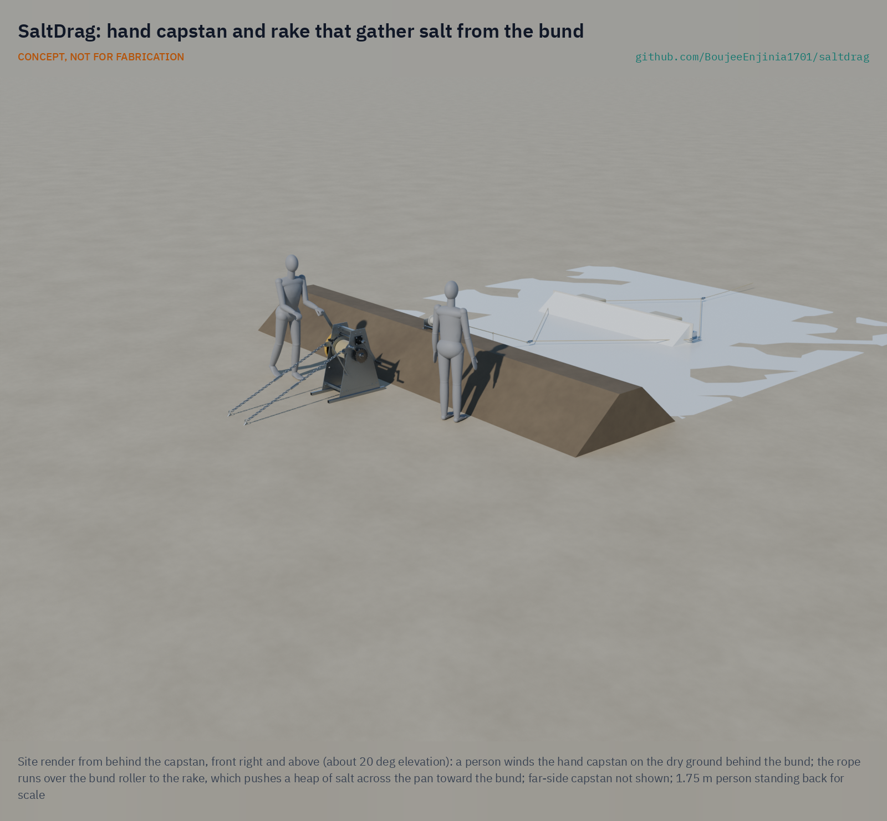
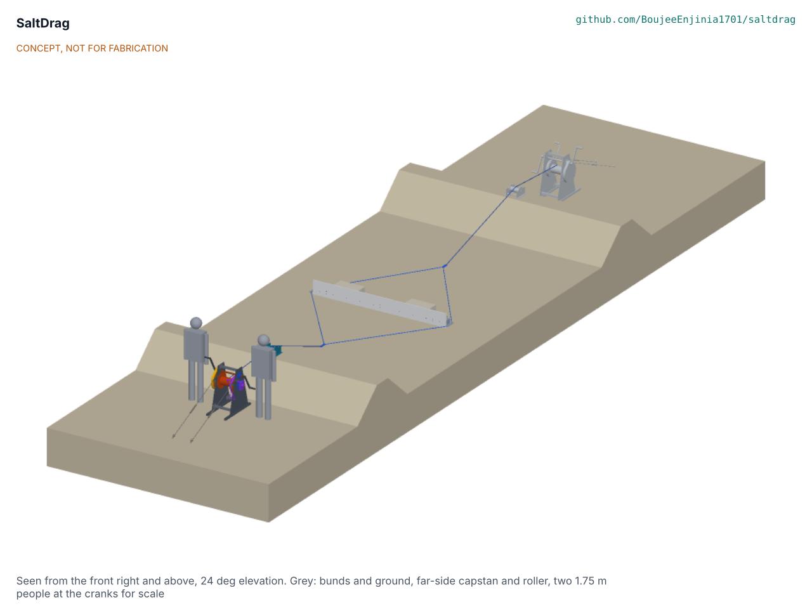
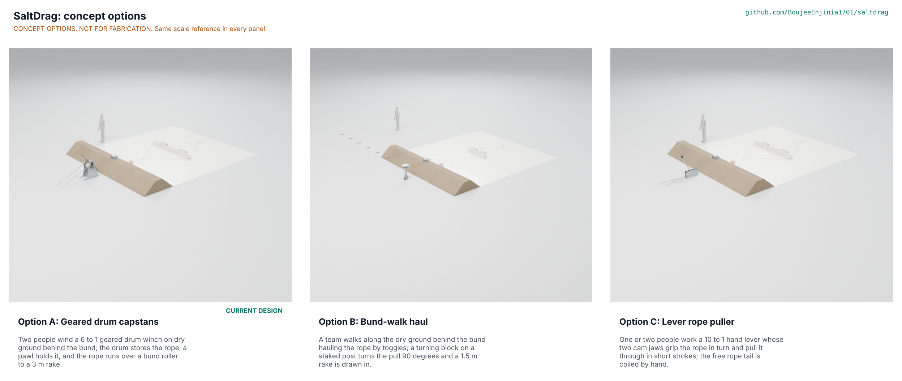
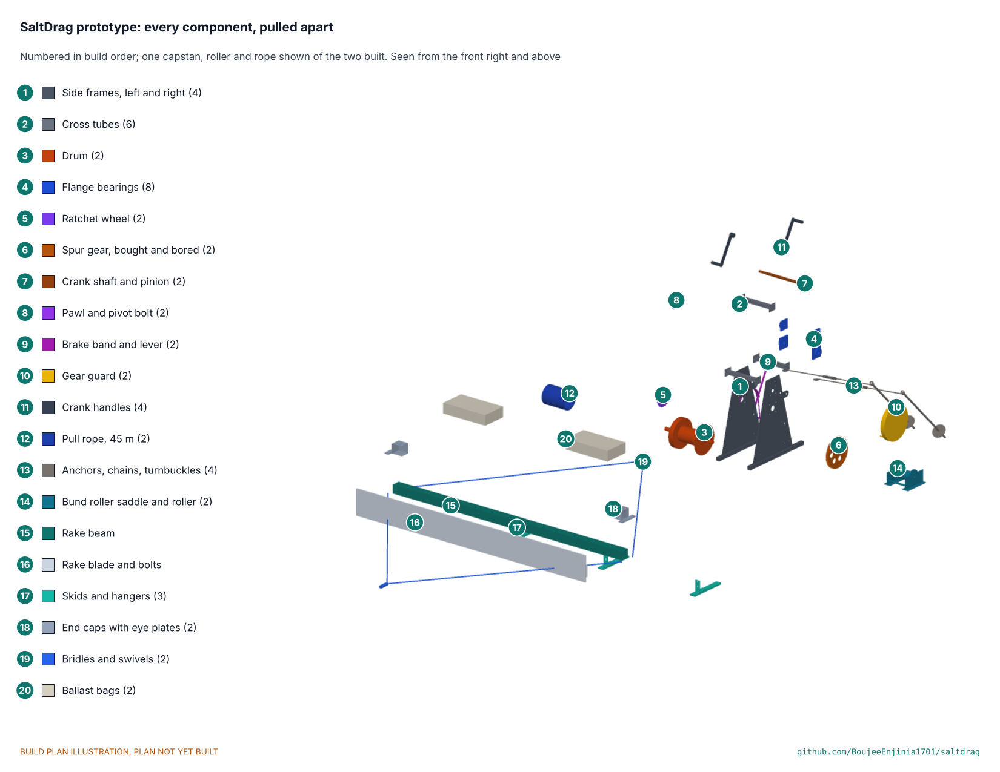

# SaltDrag

    [](https://github.com/BoujeeEnjinia1701/saltdrag/actions/workflows/reuse.yml) [](https://archive.softwareheritage.org/browse/origin/?origin_url=https://github.com/BoujeeEnjinia1701/saltdrag) [](https://doi.org/10.5281/zenodo.23128834)

**Area:** Food and water security · **TRL:** 3 of 9 (proof of concept on paper, constructable design) · **Value-engineering target:** USD 4,000; estimated parts cost USD 2,897 · **Difficulty:** 3 of 5

Drags a rake across the salt pan with hand capstans on the bunds so workers stay out of the brine.



[Exploded render](media/render-exploded.png) · [Detail render](media/render-detail.png) · [Interactive 3D model](media/viewer.html) · [Concept blueprint (PDF)](media/concept-blueprint.pdf) · [General arrangement SDG-DWG-001 (PDF)](cad/drawings/SDG-DWG-001.pdf) · [STEM check](docs/01b-stem-check.md) · [Concept options](docs/02a-concept-options.md) · [User requirements](docs/03a-user-requirements.md) · [Product requirements](docs/03-requirements.md) · [Traceability](docs/03b-traceability.md) · [Sizing note SDG-CAL-001](docs/04-calcs/01-sizing.md) · [Prototype build plan](docs/05-build-plan.md) · [Decisions](docs/06-design-decisions.md) · [Review note](docs/REVIEW.md)

CONCEPT, NOT FOR FABRICATION: a TRL 3 design documented for building and testing, not a released or certified product.

## Concept rationale

Agariya families make salt by hand, and their own words describe the cost: from extreme winter to blazing sun they bear it all, and end up with grave injuries from constantly handling salt ([Mongabay India, 2021](https://india.mongabay.com/2021/10/when-salt-is-an-essential-commodity-and-salt-makers-are-not/)). SaltDrag moves the hardest part of the harvest out of the pan. A wide rake is laid across the pan and drawn over the crystal bed by ropes from two hand capstans set on the bunds. Workers wind the capstans from dry ground and the rake gathers the salt toward the bund, instead of people standing in the brine to scrape it.

It is hand powered on purpose. Agariyas received registration cards in 2023 on condition that they keep bunds to two feet and avoid machine use ([ICSF](https://icsf.net/newss/gujarat-in-kutch-booming-salt-business-puts-traditional-salt-agariyas-up-against-ginger-prawn-fishers/)), so a motorised harvester is not an option for them. A capstan and rake set that a local fabricator can build, within a prototype ceiling of USD 4,000, fits both the rules and the budget of a community that earns a small fraction of the retail price of its salt; one set serves one family pan (SDG-CAL-001).

## Burning platform

About 60,000 Agariyas in the Little Rann of Kutch produce 30 per cent of India's inland salt, migrating to the pans for eight months a year; preparing each pan takes 40 to 45 days of manual work, and they earn about Rs 0.30 per kilogram for salt that retails at about Rs 20 ([Mongabay India, 2021](https://india.mongabay.com/2021/10/when-salt-is-an-essential-commodity-and-salt-makers-are-not/)). Salt pan workers there face severe health issues from working in harsh conditions for six to seven months at a stretch ([Wikipedia, citing The Diplomat](https://en.wikipedia.org/wiki/Little_Rann_of_Kutch)).

The collection season falls in the extreme heat of March and April ([Press Institute of India](https://pressinstitute.in/grassroots/traditional-salt-workers-contribute-to-wild-ass-conservation-and-regain-access-to-little-rann-of-kutch/)). Protective gear such as gumboots and caps has reached women workers through NGOs rather than employers ([Scroll.in](https://scroll.in/article/1007602/gujarats-plan-to-build-asias-biggest-freshwater-lake-is-a-threat-to-agariya-salt-workers)). The one big change in recent years, solar brine pumps, shows that the right hardware spreads fast: about 80 per cent of 7,000 Agariya families now have at least one solar pump ([Down To Earth](https://www.downtoearth.org.in/news/renewable-energy/great-change-in-little-rann-how-salt-workers-on-the-brink-in-gujarat-brought-about-a-solar-revolution-80652)). Harvesting has had no equivalent.

## Where it could be used

### By industry

| Industry | Use |
| --- | --- |
| Small-scale solar salt production | Gathering crystallised salt from inland and coastal pans without standing in brine |
| Cooperatives and producer groups | Harvest kits they fund, build locally and maintain for member families |
| NGOs and livelihood programmes | Occupational health intervention alongside solar pumps and protective gear |
| Artisanal salt and specialty salt makers | Gentle, even gathering of large crystals from shallow pans |
| Evaporation pond operators | Low-cost manual scraping of small ponds and settling beds |

### By country or region

| Country or region | Why it matters there |
| --- | --- |
| India, Little Rann of Kutch | About 60,000 Agariyas produce 30 per cent of India's inland salt there by hand ([Mongabay India, 2021](https://india.mongabay.com/2021/10/when-salt-is-an-essential-commodity-and-salt-makers-are-not/)). |
| India, villages around the Rann | Agariyas migrate each season from 102 villages 7 to 45 km away, and 17.5 lakh people in the area depend on salt ([Scroll.in](https://scroll.in/article/1007602/gujarats-plan-to-build-asias-biggest-freshwater-lake-is-a-threat-to-agariya-salt-workers)). |
| India, Kutch coastal creeks | Salt works around Hadakiya Creek grew from 2,962 ha in 1995 to 15,950 ha in 2015, while Agariya registration requires two-foot bunds and no machine use ([ICSF](https://icsf.net/newss/gujarat-in-kutch-booming-salt-business-puts-traditional-salt-agariyas-up-against-ginger-prawn-fishers/)). |
| India, Gujarat | Gujarat produces 76 per cent of India's salt ([Press Institute of India](https://pressinstitute.in/grassroots/traditional-salt-workers-contribute-to-wild-ass-conservation-and-regain-access-to-little-rann-of-kutch/)). |

## What sparked the idea

An Agariya salt maker in the Little Rann of Kutch described the work this way: except pumping brine from the wells, everything is done manually, and "from extreme winter to blazing sun, we bear it all. And end up with grave injuries by constantly handling salt" ([Mongabay India, 2021](https://india.mongabay.com/2021/10/when-salt-is-an-essential-commodity-and-salt-makers-are-not/)). Solar pumps have changed the brine side of that sentence. SaltDrag is aimed at the other side: the handling.

## Problem

Small-scale salt makers such as the Agariyas of the Little Rann of Kutch gather crystallised salt by hand, working inside the pans for months in extreme heat and cold. There is no low-cost, non-motorised tool that lets them gather salt from the dry bund instead. Full problem statement, with the users, stakeholders and their needs: [docs/01-problem.md](docs/01-problem.md).

## Concept

A 3 m rake is drawn across the salt pan by a rope from a hand capstan standing on dry ground behind the bund; the rope runs over a roller on the bund crest, and a second capstan on the far bund holds the rake straight and winds it back. At the estimated drag, two people at 89 N each on 330 mm cranks pull a full heap of about 230 kg across a 30 m pan in about 12 minutes, each working at up to 71 W (SDG-CAL-001). Every load-bearing part checked keeps a margin of at least 2 at twice the rated 3 kN pull. One set gathers about 195 t in a 61-day harvest, about a third of a family pan's yearly output, so one set serves one pan. The gathering rate against the traditional dantala is not yet known: it needs a baseline measured on a partner's pan. This is option A, the design of record while Amish chooses among the concept options.



Full design precis: [docs/02-concept.md](docs/02-concept.md).

## STEM check

Thirty-one claims about option A are checked against known physics, chemistry, biology and mathematics (SDG-STM-001): 25 are within known science and 6 need field data or a test at TRL 4 (the drag of a rake on a real crystal bed, the rope pressure factor on the drum barrel, the soil behind the bunds, safe working hours in the harvest heat, 316 stainless in brine and the rope's life), so the check stays open. Nine details failed on the 2026-10-03 design, four in the first check and five more found by an independent reviewer, and each was fixed under Amish's standing instruction of 2026-10-23 without changing the working principle: a slower cranking rate (23 turns a minute), a thicker drum barrel, three bolted joints redrawn, a longer brake lever for a wet lining, heavier anchor chains, lower bridle eyes so the rake cannot tip onto its blade, quenched and tempered shafts with a stepped crank shaft, hubs for the keyed gear and ratchet, and the withdrawn assumption that several families can share one set (SDG-DEC-001 D17 to D24).

## Concept options



Option A, geared drum capstans (score 158), option C, a lever rope puller (154), and option B, a bund-walk haul (148), score within 10 % of each other against the user requirements, so all three go to Amish without a pick (SDG-OPT-001, SDG-DDR-003). Option A gathers two to four times as much salt per worker and suits a family crew of four; B and C cost about half to two-thirds as much. Every option is modelled at detail level D3 in `cad/src/model.py`.

## Key components

- Hand capstans (two): geared drum winches, 6 to 1, on bolted galvanised side frames, with ratchet and pawl, band brake, gear guard and removable cranks
- Screw-in helical ground anchors, 10 mm chains and rated turnbuckles
- Bund roller saddles (two)
- Rake: 3.0 m FRP beam, 300 mm UHMW-PE blade, three skids on slotted stainless hangers, stainless end caps with low bridle eyes
- Pull ropes (12 mm polyester, 45 m each), bridles and swivels
- Rope dampers, ballast bags and a maintenance kit

## Building the prototype

The build plan ([docs/05-build-plan.md](docs/05-build-plan.md)) takes a town fabrication shop through all 20 kinds of component in build order, with a making sketch for each made part, close-ups of the joints and a picture for every one of the 18 assembly steps. The capstans are cut, drilled and welded from steel plate and box section and then galvanised; the gears, bearings, anchors and ropes are bought; the rake is drilled FRP and plastic with stainless fittings. The plan is a plan, not yet built: it ends with first checks and the safety stops before any rope is loaded. The parts cost about USD 2,897 against a value-engineering target of USD 4,000.



## Safety

> Ropes under load can snap back. The design uses certified low-stretch polyester rope (working-load factor 7.7), a damper bag on every loaded rope and a 2 m exclusion zone along the rope line.
>
> Capstans have a pawl that is always engaged while winding, so a released crank cannot spin back; rope is paid out only on the band brake, with the crank handles removed. The gears run inside a guard.
>
> Ground anchors are proof-pulled on site to 3.42 kN before first use, and both chains are kept equally tight; the build plan lists safety stops before any rope load.
>
> Heat is a serious hazard in the harvest season; plan work for the cooler hours and provide shade, water and rest.
>
> This design is published as an open engineering reference. It is not certified lifting or rope equipment.

## Repository layout

```
docs/                 controlled documents (PRB, STM, OPT, PRC, URS, PRS, RTM, CAL, BLD, DEC, REG, FEA, RSK, MKT, PLN, DDR) and REVIEW.md
docs/04-calcs/        sizing.py (SDG-CAL-001) and stem_check.py (SDG-STM-001)
cad/src/model.py      parametric model of options A, B and C (kit 1.9, detail level D3)
cad/src/              sheets.py, build_plan_media.py, concept_media.py, product_model.py, sdg_parts.py
cad/step/, cad/stl/   STEP per part of option A, an assembly STEP per option, STL of the main assemblies
cad/fidelity.json     result of the CAD fidelity check
cad/drawings/         SDG-DWG-001 general arrangement and SDG-DWG-101 to 113 making sketches
bom/bom.csv           priced bill of materials
media/                concept media and renders
.kit/                 shared documentation kit 1.9.1 (do not edit here)
```

## Documentation

Controlled documents follow the portfolio standards in [.kit/STANDARDS.md](.kit/STANDARDS.md). Each carries a document ID (SDG-PRC-001 for the precis), a version and a revision history. Run `python .kit/render.py --check` to validate them, `python .kit/cad_check.py --export` for the CAD fidelity check, `python docs/04-calcs/sizing.py` for the calculations and `python docs/04-calcs/stem_check.py` for the STEM check. Branded PDFs are built with `python .kit/render.py`.

## Credits

Designed by Amish Chadha at Design Molecule Labs. See [CONTRIBUTORS.md](CONTRIBUTORS.md) for roles. To cite this design, use [CITATION.cff](CITATION.cff) (GitHub shows it as "Cite this repository").

AI assistance (Claude) was used to accelerate prototype documentation and first-pass research. Design direction and all decisions are Amish Chadha's, recorded in this repository's decision records (`docs/decisions/`).

## Licenses

- **Hardware** (CAD, drawings, BOM, electronics): [CERN-OHL-S v2](LICENSE)
- **Software** (firmware, scripts, notebooks): [MIT](LICENSE-SOFTWARE)

A project of the [Design Molecule](https://designmolecule.com) lab.
